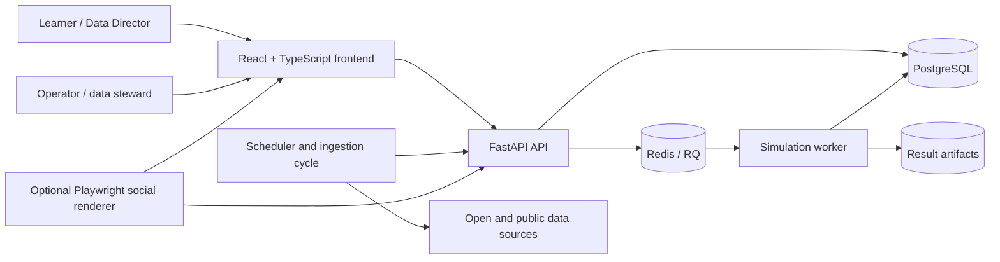

# Mundial Lab — Concept Note

## Document purpose

This concept note describes the product that is present in this repository. It
separates implemented capabilities from proposed extensions and does not make
claims about predictive accuracy, real-time coverage, commercial readiness, or
future delivery dates.

## Executive summary

Mundial Lab is an educational football analytics laboratory built around the
2026 World Cup. It turns probabilistic models, tournament simulations, live
match interpretation, and data provenance into an interactive control-room
experience.

The repository combines a public web experience with a Python API, auditable
data ingestion, model execution, background jobs, persistent storage, and
operator workflows. Participants act as "Data Directors": they inspect a
match, select a model, adjust the parameters that the model can actually use,
record a probabilistic reading, and compare that reading with observed results
and model-generated baselines.

Mundial Lab should currently be understood as an integrated research and
showcase prototype. It contains substantial product, data, and infrastructure
work, but several models still use seed, derived, or simulated inputs; identity
is alias-based; and the public deployment configuration requires additional
operator-controlled infrastructure.

## Problem and opportunity

Sports-prediction interfaces often present a probability without showing where
it came from, what evidence changed it, or how uncertainty should be evaluated.
That makes the result difficult to learn from and easy to mistake for certainty.

Mundial Lab addresses a different opportunity: use a familiar tournament as a
hands-on environment for probabilistic literacy. The product can make the
following ideas observable rather than abstract:

- different models answer different questions;
- a parameter should only appear when it changes a real calculation;
- predictions should be tied to a data snapshot, model version, parameters,
  and random seed;
- live evidence should update a prior rather than erase it;
- a forecast becomes more useful when it can be scored, audited, and examined
  after the event; and
- public, estimated, manually entered, and simulated data should never be
  presented as equivalent.

The commercial and institutional opportunity is therefore not limited to a
World Cup forecast. The repository demonstrates a reusable pattern for
educational analytics, model explainability, auditable simulation, and
data-driven public engagement.

## Vision

The product vision is a scientifically honest football control room in which a
participant can:

1. understand the assumptions behind a model;
2. operate that model before and during a match;
3. see how probabilities change as evidence changes;
4. preserve the exact context of each run; and
5. learn from the difference between the forecast and the observed outcome.

The experience is intended to remain engaging and football-native without
turning uncertainty into a promise. It is an educational analytics product,
not a betting service and not an official tournament data service.

## Intended users

The current product direction supports four primary user groups:

- **Learners and educators** exploring probability, Monte Carlo simulation,
  model calibration, data provenance, and evidence updates through football.
- **Football and data enthusiasts** who want to compare model assumptions and
  record their own probabilistic readings as Data Directors.
- **Researchers and analysts** evaluating an explainable workflow for model
  runs, snapshots, match lines, data quality, and post-match autopsies.
- **Operators and data stewards** capturing match state, verifying results,
  running ingestion and simulation cycles, and reviewing publication outputs.

The repository also functions as a technical demonstration for prospective
partners. It does not yet contain organization accounts, subscriptions, or a
production-grade multi-tenant authorization model.

## Value proposition

Mundial Lab brings together capabilities that are frequently separated:

- an approachable visual experience for non-specialists;
- model-specific controls and explanations;
- synchronous and queued simulations;
- provenance-aware data ingestion;
- explicit confidence levels for data;
- reproducible model runs and saved match lines;
- post-result model autopsies and a learning log; and
- one containerized path from frontend to database and worker.

The differentiator is not a claim to know the winner. It is the ability to show
what the system believed, which inputs supported that belief, what changed, and
what can be learned afterward.

## Current capabilities

### Public experience

- A React and TypeScript frontend built with Vite, with Three.js available for
  spatial and animated model experiences.
- A versioned 104-match tournament fixture and 104 match-room entry pages.
- A main dashboard, match catalogue, match control-room views, model pages,
  a data laboratory, learning log, Data Director view, house Monte Carlo view,
  and technical/backend explanation pages.
- Dedicated educational surfaces for Elo, Poisson, Dixon-Coles, Bayesian live
  updating, and ensemble modelling.
- Lightweight local simulation and API-backed execution paths, allowing the
  interface to retain demonstrative value when the full backend is unavailable.

### API and simulation

- A FastAPI application exposing teams, models, matches, match enrichment,
  public data-quality summaries, simulations, saved house lines, evolution,
  daily editorials, autopsies, and a learning log.
- Inline tournament simulations with an enforced upper bound and Redis/RQ jobs
  for larger runs.
- A tournament simulator with model selection and seeded execution.
- A house simulation workflow that can incorporate stadium adjustments, fixed
  results, and available xG-derived inputs.
- Persistent result files plus database records for model runs, match lines,
  verified results, confirmations, and autopsies.

### Live and operator workflows

- Alias registration and storage of participant predictions.
- Match status, minute, score, and event capture through operator endpoints.
- Administrative ingestion endpoints for international results, current match
  results, match enrichment, StatsBomb Open Data, and stadium weather.
- A smart automation scheduler with live, closing, upcoming, and idle windows.
- Optional generation, approval, storage, and publication support for social
  cards. External publishing depends on separately supplied platform
  credentials and is not enabled by default in the provided environment.

### Data auditability

- Source snapshots, ingestion jobs, source URLs, versions, trust levels, and
  structured error capture.
- Tables for historical results, team-strength snapshots, line-ups, live
  features, shots, stadium conditions, verified results, model runs, match
  lines, autopsies, and social-publication records.
- A five-level data vocabulary: `real_verificado`, `publico_ingestado`,
  `manual_admin`, `estimado`, and `simulado`.
- Post-match workflows that preserve an original line and generate an
  explanatory autopsy when sufficient data is available.

## Model status

The model catalogue marks Elo, Poisson, and Ensemble as active, while
Dixon-Coles and Bayes Live are prototypes. "Active" describes availability in
the application; it is not evidence of external validation or calibrated
forecasting performance.

The repository's own data audit identifies mixed maturity:

- the full fixture is structured and versioned;
- team strengths begin with a limited technical seed and can be updated from
  historical international results;
- the backend tournament simulation uses simplified Elo and Poisson logic;
- the frontend match experience includes more advanced player, venue, and live
  controls, some of which currently depend on derived or simulated inputs;
- Dixon-Coles does not yet fit its low-score correlation from a historical
  sample; and
- live Bayesian evidence is not yet supplied by a complete real-time event
  feed.

Any public interpretation should therefore distinguish an educational model
demonstration from a calibrated forecasting claim.

## Architecture

### Component responsibilities

- **Frontend:** product experience, model explanations, controls,
  visualizations, public results, and operator screens.
- **FastAPI backend:** validation, public and administrative API contracts,
  data access, simulation orchestration, ingestion, and audit workflows.
- **PostgreSQL:** production-oriented persistence for fixtures, participants,
  predictions, source snapshots, enrichment, runs, lines, and autopsies.
- **SQLite:** local fallback when `DATABASE_URL` is absent; it is not the
  recommended production store.
- **Redis and RQ:** asynchronous simulation queue for work that should not
  block the web request.
- **Worker:** execution of queued model runs and persistence of artifacts.
- **Automation service:** fixture-aware ingestion, line generation, enrichment,
  weather, autopsy, and optional social-publication cycles.
- **Social renderer:** an optional Playwright-based tool for rendering and
  processing publication-ready visual assets.

## Data sources, provenance, and attribution

### Versioned repository data

The repository contains a 104-match fixture seed, a team-strength seed, and
dated result/confirmation snapshots. Seed values support navigation and the
prototype; they should not automatically be treated as verified competitive
data.

### Implemented external connectors

- `martj42/international_results` for historical international match results
  used in strength and Elo-oriented workflows.
- ESPN public scoreboard data for completed-result discovery.
- FOX Sports score pages as a secondary exact-score confirmation attempt.
- ESPN summary data for available rosters, line-ups, team statistics,
  commentary, and shot information.
- StatsBomb Open Data for controlled historical event, line-up, shot, and xG
  examples where coverage exists.
- Open-Meteo geocoding and forecast APIs for venue and kickoff weather.

Football-Data.co.uk and FIFA are discussed in the research documentation as
potential calibration or primary-verification references, but this repository
does not provide a general ingestion pipeline for either source.

### Provenance policy

External acquisition should prefer documented JSON APIs and open datasets over
HTML extraction. Loaders should cache source material, record source URL and
version, preserve ingestion errors, and write through internal normalization
logic rather than directly into model tables. Missing xG or other evidence must
remain null instead of being presented as observed data.

Third-party data, names, marks, and software remain subject to their own terms.
In particular, StatsBomb Open Data attribution and conditions must be retained.
See [Third-party notices](../THIRD_PARTY_NOTICES.md).

## Security and privacy posture

The public snapshot excludes runtime secrets and provides an environment
template rather than credentials. Production services are designed to receive
database, administrative, email, and social-platform secrets through
environment variables. The production and direct-VPS manifests avoid exposing
PostgreSQL and Redis publicly; the direct-VPS override binds frontend and API
ports to loopback for use behind an operator-managed reverse proxy.

Administrative endpoints use an `X-Admin-Token` header. In the current code,
that control is only enforced when `ADMIN_TOKEN` has a value. A production
deployment must therefore set a strong token and should be changed to fail
closed when it is missing. CORS must likewise be restricted with an explicit
production origin rather than relying on the development default.

Participant identity is currently an alias, not an authenticated account.
Alias registration and prediction submission are public endpoints, and the
leaderboard is a prototype. Before exposing competitive accounts or accepting
untrusted public traffic at scale, the system needs durable identity,
authorization, abuse controls, rate limiting, input-volume controls, retention
rules, and operator audit policy.

The simulation request schema accepts an optional email address, but the queued
job currently does not send a notification. A future notification workflow
must define consent, retention, delivery-provider terms, and deletion behavior
before collecting email for that purpose.

Security reports should use GitHub private vulnerability reporting as described
in [SECURITY.md](../SECURITY.md), not a public issue containing sensitive
details.

## Deployment and operations

The repository provides three Docker Compose views:

- `docker-compose.yml` for local development with frontend, API, worker,
  automation, PostgreSQL, and Redis;
- `docker-compose.prod.yml` for a production-shaped stack with static Nginx
  frontend, API workers, persistent PostgreSQL and Redis, automation, optional
  social rendering, and a Caddy edge service; and
- `docker-compose.vps-direct.yml` for loopback-only frontend and backend ports
  behind an external reverse proxy.

Persistent production volumes are defined for PostgreSQL, Redis, generated
results, and Caddy state. GitHub Actions currently run backend tests and a
frontend production build; they do not deploy the application.

The production Compose file references `infra/caddy/Caddyfile`, which is not
part of this public snapshot. The production stack is therefore a deployment
reference, not a turn-key public release. An operator must supply and review
the edge configuration, DNS, TLS routing, secrets, backups, monitoring,
resource limits, logging, and recovery procedures before launch.

## Product maturity

Mundial Lab is best classified as an **integrated research and showcase
prototype**:

- product surfaces, API contracts, persistence, queueing, ingestion, and CI
  exist;
- the full tournament fixture and match navigation are present;
- automated tests cover selected backend model, live, enrichment, scheduler,
  and autopsy behavior;
- the data model contains meaningful provenance and audit structures; but
- model calibration, public identity, abuse protection, production edge
  configuration, observability, and operational validation remain incomplete.

It should not yet be represented as an official source, a real-time feed, a
validated decision system, or a production betting product.

## Known limitations

- Several player, stadium, form, and live-evidence values remain derived or
  simulated.
- Historical calibration and backtesting are not complete across models.
- Dixon-Coles and Bayes Live remain prototype modules.
- The leaderboard uses an interim score rather than the full scoring framework
  described in the product plan.
- Alias-based participation provides no account ownership or recovery.
- Public mutation endpoints need authentication and abuse controls before an
  open production launch.
- Email notification is described as a direction but is not implemented in the
  current queue worker.
- External feeds have selective coverage and may change availability or
  structure; they are not guaranteed live services.
- Production edge configuration and operating procedures are not included in
  this public snapshot.

## Roadmap direction

The following sequence consolidates the roadmap already documented in the
repository. It is a direction for evaluation, not a delivery commitment.

### 1. Establish a safe production baseline

- Make administrative authorization fail closed.
- Introduce authenticated user and operator roles.
- Add rate limiting, abuse prevention, retention rules, and auditable operator
  actions.
- Complete the reverse-proxy configuration, backups, monitoring, health checks,
  resource limits, and recovery exercises.

### 2. Strengthen data truth and traceability

- Surface each input's trust level in the product.
- Ingest and version historical international results consistently.
- Convert operator-entered events into traceable live features.
- Preserve dataset manifests and the exact snapshot used by every run.

### 3. Calibrate and evaluate the models

- Train historical Elo and team-strength series.
- Fit and backtest Poisson and Dixon-Coles parameters.
- Store minute-by-minute Bayesian posteriors when evidence is available.
- Compare Brier score, log loss, calibration, goal error, and context-specific
  model behavior without presenting retrospective tuning as foresight.

### 4. Complete the Data Director experience

- Replace the interim leaderboard score with the documented scoring framework.
- Add authenticated prediction windows and post-match explanations.
- Make the contribution and limitations of each ensemble component visible.
- Preserve a snapshot of every competitive prediction before the outcome.

### 5. Productize optional communication workflows

- Implement consent-based email delivery if it remains useful.
- Keep social publication approval-first and auditable.
- Treat external platforms as replaceable adapters rather than core model
  dependencies.

## Governance

The repository documents a working division of responsibilities:

- **Polisplexity** leads the public experience, product experiments,
  simulation interfaces, visualization, and public-facing interpretation.
- **Hadox** leads scientific infrastructure, APIs, data workflows, heavier
  computation, and internal deployment operations.

For the product to mature, changes to models and data should be reviewed with
the same discipline as application code. A model-affecting change should state
its input sources, trust levels, parameters, evaluation method, expected
limitations, and compatibility with saved runs. Data-source changes should
preserve attribution, licenses, source URLs, and ingestion history. Production
changes should pass the repository's build and test workflow and follow an
operator-approved release process.

## License and permitted use

This repository is publicly visible but is **not open source**. Original Hadox
and Polisplexity software, design, documentation, models, and methodology are
provided under the repository's proprietary source-available license. Viewing
the source for evaluation does not grant permission to copy, modify,
redistribute, host, sell, sublicense, or create derivative works.

Third-party software and datasets retain their respective licenses and terms.
Refer to [LICENSE](../LICENSE) and
[THIRD_PARTY_NOTICES.md](../THIRD_PARTY_NOTICES.md) before any use.
