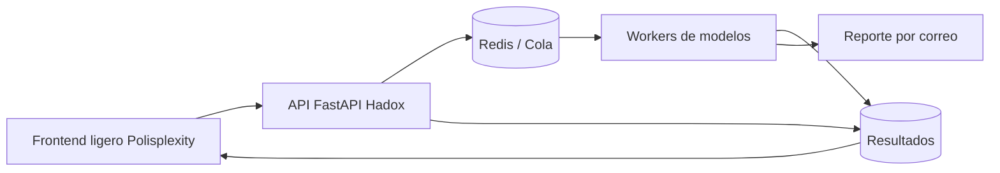

# Arquitectura

Mundial Lab separa la experiencia web del computo pesado.

## Principios

- El navegador solo visualiza, configura y consulta.
- Las simulaciones grandes se ejecutan como jobs.
- Cada resultado debe registrar modelo, parametros, snapshot de datos y seed.
- Los modelos se explican en lenguaje para estudiantes.

## Deployment recomendado

La arquitectura publica debe reflejar la division de marca:

- `mundial.hadox.org`: experiencia publica, frontend, paginas educativas, visualizaciones y resultados compartibles.
- `api-mundial.hadox.org`: API, cola de simulaciones, workers, datos, reportes y correo.
- Infraestructura CI/CD privada: ruta preferente para backend privado o semiprivado cuando haya secretos, jobs largos, datos enriquecidos o infraestructura sensible.
- GitHub Pages: buena ruta para el frontend publico, especialmente si se usa `mundial.hadox.org` como dominio canonico. Evitaria dejar la URL principal como `github.io` porque el proyecto es showcase de marca, no solo demo tecnica.

Esta combinacion permite decir claramente: Polisplexity hizo la experiencia publica; Hadox opera los modelos, datos y computo.

## Modelos iniciales

- Elo logistico: fuerza relativa simple y pedagogica.
- Poisson: genera marcadores a partir de goles esperados.
- Ensemble: mezcla ratings, forma reciente y perfil ofensivo/defensivo.

## Siguientes modelos

- Bradley-Terry-Davidson para empate.
- Dixon-Coles para corregir 0-0, 1-0, 1-1.
- Bayes live para actualizar creencias con resultados manuales.
